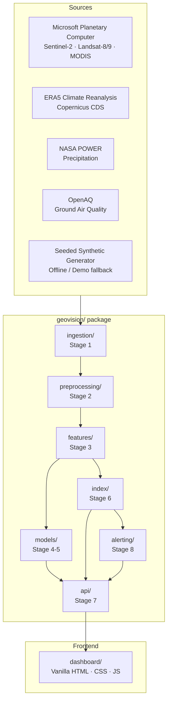

# GeoVision AI — Complete Project Summary

> **Global near real-time environmental intelligence and forecasting platform**
> Semester 7 · Data Analytics & Visualization (DAV) project

---

## 🎯 What It Does

GeoVision AI ingests satellite and climate data, runs ML/DL models on it, fuses the results into a single **Environmental Health Index (EHI)**, exposes everything through a REST API, and displays it on an interactive dashboard with automated alerting. The pipeline is 8 stages end-to-end:

```
Data sources → Ingestion/Preprocessing → Feature Engineering →
ML/DL Analytics → Index Fusion → API → Dashboard → Alerting
```

---

## 🏗️ Architecture Overview



---

## 📁 Project Structure

| Path | Role |
|---|---|
| [`geovision/config.py`](file:///c:/Users/rijul/Desktop/College/SEM-7/DAV/Code%202/geovision-ai/geovision/config.py) | Central settings · credentials · Region Registry (13 regions) |
| [`geovision/ingestion/`](file:///c:/Users/rijul/Desktop/College/SEM-7/DAV/Code%202/geovision-ai/geovision/ingestion) | Stage 1 — 5 live data clients + synthetic fallback + pipeline orchestrator |
| [`geovision/preprocessing/`](file:///c:/Users/rijul/Desktop/College/SEM-7/DAV/Code%202/geovision-ai/geovision/preprocessing) | Stage 2 — cloud masking, range validation, gap-fill, normalization |
| [`geovision/features/`](file:///c:/Users/rijul/Desktop/College/SEM-7/DAV/Code%202/geovision-ai/geovision/features) | Stage 3 — NDVI/NDWI computation, rolling stats, anomaly detection, PCA |
| [`geovision/models/`](file:///c:/Users/rijul/Desktop/College/SEM-7/DAV/Code%202/geovision-ai/geovision/models) | Stages 4-5 — RF · XGBoost classifiers + CNN · LSTM · Transformer forecasters |
| [`geovision/index/`](file:///c:/Users/rijul/Desktop/College/SEM-7/DAV/Code%202/geovision-ai/geovision/index) | Stage 6 — Environmental Health Index fusion |
| [`geovision/api/`](file:///c:/Users/rijul/Desktop/College/SEM-7/DAV/Code%202/geovision-ai/geovision/api) | Stage 7 — FastAPI app · 6 REST endpoints · startup cache warm-up |
| [`geovision/alerting/`](file:///c:/Users/rijul/Desktop/College/SEM-7/DAV/Code%202/geovision-ai/geovision/alerting) | Stage 8 — threshold & rapid-decline alert generation |
| [`dashboard/`](file:///c:/Users/rijul/Desktop/College/SEM-7/DAV/Code%202/geovision-ai/dashboard) | Static frontend: `index.html` · `styles.css` · `app.js` · `demo_data.json` |
| [`tests/`](file:///c:/Users/rijul/Desktop/College/SEM-7/DAV/Code%202/geovision-ai/tests) | pytest suite — pipeline · models · alerts · API |
| [`scripts/run_demo.py`](file:///c:/Users/rijul/Desktop/College/SEM-7/DAV/Code%202/geovision-ai/scripts) | CLI end-to-end demo → writes `dashboard/demo_data.json` |

---

## 🛰️ Stage 1 — Data Ingestion

Four live clients, each implementing `BaseIngestionClient.fetch(region_id, start, end) → list[Observation]`:

| Client | Source | Variables | Credentials |
|---|---|---|---|
| [`planetary_computer_client.py`](file:///c:/Users/rijul/Desktop/College/SEM-7/DAV/Code%202/geovision-ai/geovision/ingestion/planetary_computer_client.py) | Microsoft Planetary Computer (STAC) | NDVI, NDWI from Sentinel-2, Landsat-8/9, MODIS | None required (optional key for higher rate limits) |
| [`era5_client.py`](file:///c:/Users/rijul/Desktop/College/SEM-7/DAV/Code%202/geovision-ai/geovision/ingestion/era5_client.py) | Copernicus CDS — ERA5 reanalysis | `temperature_2m` | `CDS_API_KEY` |
| [`precipitation_client.py`](file:///c:/Users/rijul/Desktop/College/SEM-7/DAV/Code%202/geovision-ai/geovision/ingestion/precipitation_client.py) | NASA POWER REST API | `precipitation_total` | None required |
| [`openaq_client.py`](file:///c:/Users/rijul/Desktop/College/SEM-7/DAV/Code%202/geovision-ai/geovision/ingestion/openaq_client.py) | OpenAQ v3 | `pm25`, `no2` | `OPENAQ_API_KEY` |
| [`synthetic.py`](file:///c:/Users/rijul/Desktop/College/SEM-7/DAV/Code%202/geovision-ai/geovision/ingestion/synthetic.py) | Seeded RNG (fallback) | All variables | None |

[`pipeline.py`](file:///c:/Users/rijul/Desktop/College/SEM-7/DAV/Code%202/geovision-ai/geovision/ingestion/pipeline.py) orchestrates all sources and silently substitutes the synthetic generator per-source when credentials are missing — the rest of the pipeline never knows.

---

## 🧮 Stage 6 — Environmental Health Index (EHI)

Defined in [`health_index.py`](file:///c:/Users/rijul/Desktop/College/SEM-7/DAV/Code%202/geovision-ai/geovision/index/health_index.py):

```
EHI = 0.30 × air_quality + 0.25 × vegetation + 0.25 × water + 0.20 × climate
```

Each sub-index is rescaled to **0 (poor) → 100 (excellent)** using physical bounds:

| Sub-Index | Raw Variables | Direction |
|---|---|---|
| `air_quality` | PM2.5 (60%) + NO₂ (40%) | Higher raw = worse → inverted |
| `vegetation` | NDVI | Higher = better |
| `water` | NDWI | Higher = better |
| `climate` | Precipitation (50%) + Temperature distance from 22°C (50%) | Mixed |

Rows with partial NaN data (e.g. cloudy days missing satellite passes) still get an EHI, with weights renormalized on available sub-indices.

---

## 🤖 Stages 4–5 — ML/DL Models

### Classification (condition: Healthy / Stressed / Degraded)

| Model | Implementation |
|---|---|
| Random Forest (300 trees) | scikit-learn `RandomForestClassifier` |
| XGBoost | `XGBClassifier` with `multi:softprob` objective |

Features: `ndvi`, `ndwi`, `temperature_2m`, `precipitation_total`, `pm25`, `no2`, and derived anomaly/PCA columns. Labels derived via rule-based proxy (NDVI z-score, PM2.5 z-score, precipitation z-score) until ground-truth data is available.

Metrics reported: **Accuracy, Cohen's Kappa, ROC-AUC**

### Forecasting (multi-horizon time-series)

All implemented via the `SequenceForecaster` wrapper in [`forecasting.py`](file:///c:/Users/rijul/Desktop/College/SEM-7/DAV/Code%202/geovision-ai/geovision/models/forecasting.py) (PyTorch, lazy import):

| Architecture | Details |
|---|---|
| **LSTM** | 2-layer, hidden=64, dropout=0.1 |
| **CNN** | 2× Conv1D (32 channels) + AdaptiveAvgPool |
| **Transformer** | d_model=32, 4 heads, 2 encoder layers, positional embeddings |

All use z-score normalization internally, 30-day lookback, configurable forecast horizon (default 14 days). Metrics: **RMSE, MAE, R²**

---

## 🌐 Stage 7 — REST API

Built with **FastAPI**, served by **uvicorn**. The dashboard mounts as a static site at `/`.

| Endpoint | Description |
|---|---|
| `GET /api/regions` | Region registry (id, name, level, coordinates) |
| `GET /api/ehi?region_id=IN&days=180` | EHI + sub-index time-series for one region |
| `GET /api/compare?region_ids=IN,US,BR&days=180` | Latest snapshot across multiple regions |
| `GET /api/alerts?region_ids=IN,US&days=90` | Active threshold / rapid-decline alerts |
| `GET /api/train?region_id=IN&days=240&horizon=14&epochs=40` | Full ML/DL training run → validation metrics |
| `GET /api/health` | Liveness check |
| `GET /api/cache/status` | Memory + disk cache inspection |
| `POST /api/cache/clear` | Flush all caches |
| `GET /docs` | Auto-generated Swagger UI |

On startup, all 13 regions are **pre-warmed in a thread pool** (4 workers) so the dashboard loads instantly after the first run.

---

## 🗺️ Region Registry (13 Regions)

| ID | Name | Level |
|---|---|---|
| `IN` | India | country |
| `US` | United States | country |
| `BR` | Brazil | country |
| `AU` | Australia | country |
| `KE` | Kenya | country |
| `ID` | Indonesia | country |
| `MH-IN` | Maharashtra, India | state |
| `CA-US` | California, USA | state |
| `MUM-IN` | Mumbai, India | city |
| `SP-BR` | São Paulo, Brazil | city |
| `AS` | Asia | continent |
| `AF` | Africa | continent |
| `SA` | South America | continent |

---

## 🚨 Stage 8 — Alerting

Two alert types:
- **Threshold alerts** — sub-index or composite EHI falls below configured floor (e.g. `air_quality < 40`, `composite < 45`)
- **Rapid-decline alerts** — sudden drop in any sub-index over a short rolling window

---

## 🖥️ Dashboard (Frontend)

Pure **vanilla HTML/CSS/JS** — no framework.

| File | Contents |
|---|---|
| [`index.html`](file:///c:/Users/rijul/Desktop/College/SEM-7/DAV/Code%202/geovision-ai/dashboard/index.html) | Structure, semantic HTML |
| [`styles.css`](file:///c:/Users/rijul/Desktop/College/SEM-7/DAV/Code%202/geovision-ai/dashboard/styles.css) | ~600 lines of custom CSS (15.8 KB) |
| [`app.js`](file:///c:/Users/rijul/Desktop/College/SEM-7/DAV/Code%202/geovision-ai/dashboard/app.js) | ~1000 lines — API calls, canvas charts, region comparison (~29 KB) |
| [`demo_data.json`](file:///c:/Users/rijul/Desktop/College/SEM-7/DAV/Code%202/geovision-ai/dashboard/demo_data.json) | 600 KB pre-generated snapshot for static/offline use |

The dashboard tries the live API first; if unreachable, it falls back to `demo_data.json` automatically.

---

## 🧪 Testing

| File | Coverage |
|---|---|
| [`test_pipeline.py`](file:///c:/Users/rijul/Desktop/College/SEM-7/DAV/Code%202/geovision-ai/tests/test_pipeline.py) | Ingestion pipeline · synthetic fallback · data shapes |
| [`test_models.py`](file:///c:/Users/rijul/Desktop/College/SEM-7/DAV/Code%202/geovision-ai/tests/test_models.py) | RF/XGBoost training · LSTM/CNN/Transformer forecasting |
| [`test_alerts.py`](file:///c:/Users/rijul/Desktop/College/SEM-7/DAV/Code%202/geovision-ai/tests/test_alerts.py) | Threshold & rapid-decline alert logic |
| [`test_api.py`](file:///c:/Users/rijul/Desktop/College/SEM-7/DAV/Code%202/geovision-ai/tests/test_api.py) | FastAPI endpoints via `TestClient` |

Run: `pytest` (~10s full suite) · `pytest -m "not slow"` to skip the `/api/train` integration test.

---

## 📦 Key Dependencies

| Category | Libraries |
|---|---|
| Core data | `pandas ≥ 2.2`, `numpy ≥ 1.26` |
| Classical ML | `scikit-learn ≥ 1.4`, `xgboost ≥ 2.0` |
| Deep learning | `torch ≥ 2.2` (CNN, LSTM, Transformer) |
| API serving | `fastapi ≥ 0.110`, `uvicorn[standard] ≥ 0.29` |
| Satellite data | `pystac-client`, `planetary-computer`, `rioxarray`, `odc-stac` |
| Climate data | `cdsapi` (ERA5), `requests` (OpenAQ, NASA POWER) |
| Testing | `pytest ≥ 8.0` |

---

## ⚙️ How to Run

```bash
# 1. Setup
python3 -m venv .venv && .venv\Scripts\activate  # Windows
pip install -r requirements.txt

# 2. Demo (no credentials needed — uses synthetic data)
python scripts/run_demo.py          # generates demo_data.json

# 3. Full stack
uvicorn geovision.api.main:app --reload
# → http://127.0.0.1:8000  (dashboard + API + /docs)

# 4. Tests
pytest
pytest -m "not slow"
```

---

## ⚠️ Current Limitations

> [!WARNING]
> All numbers visible in the dashboard (EHI values, alerts, model metrics) are from the **seeded synthetic generator**, not real satellite/climate data — no live credentials are wired in by default.

> [!NOTE]
> The condition labels (`Healthy / Stressed / Degraded`) are **rule-based proxies**, not field-verified ground truth. Replace `derive_condition_labels()` in `classifiers.py` with real labeled data before trusting classification metrics.

> [!CAUTION]
> `/api/train` is **synchronous** — fine for demos, but blocks the request thread for ~10–15s. For production, move it behind a task queue (e.g. Celery, ARQ) with a job-status polling endpoint.
